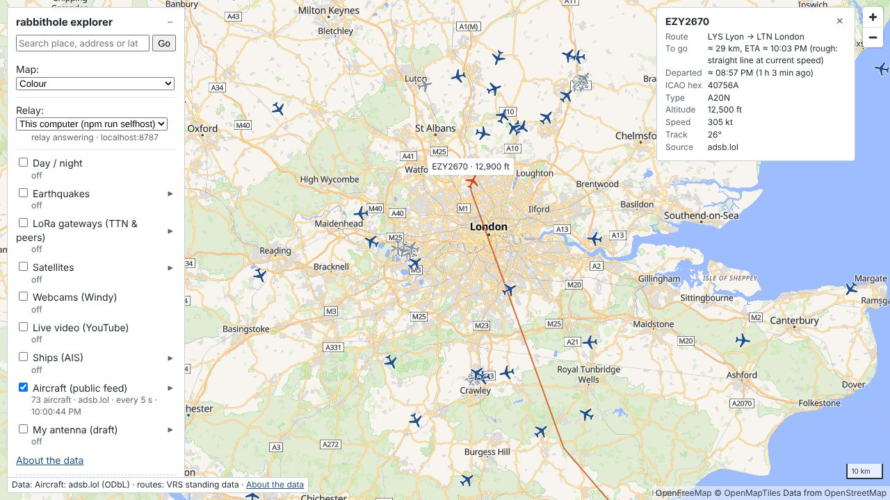
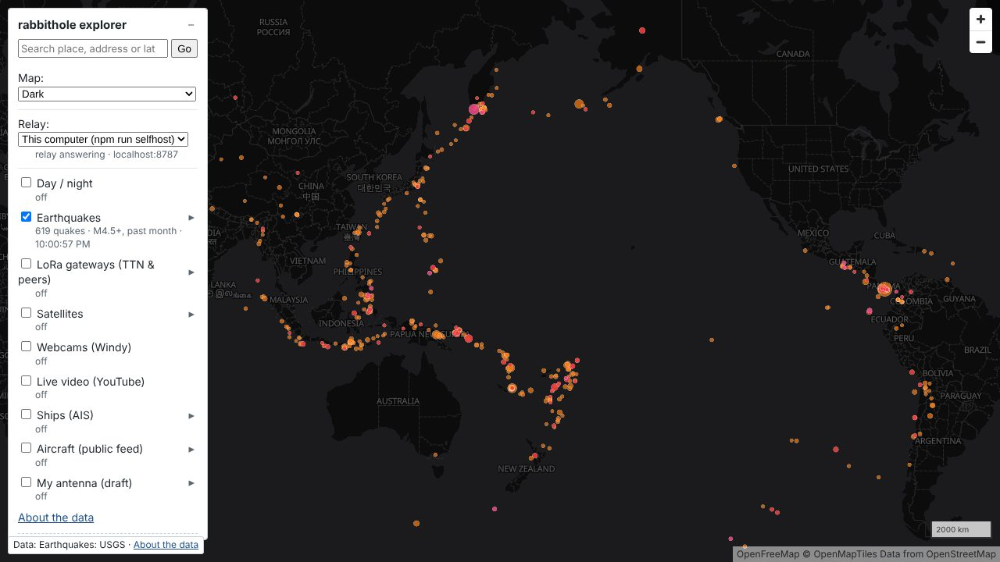
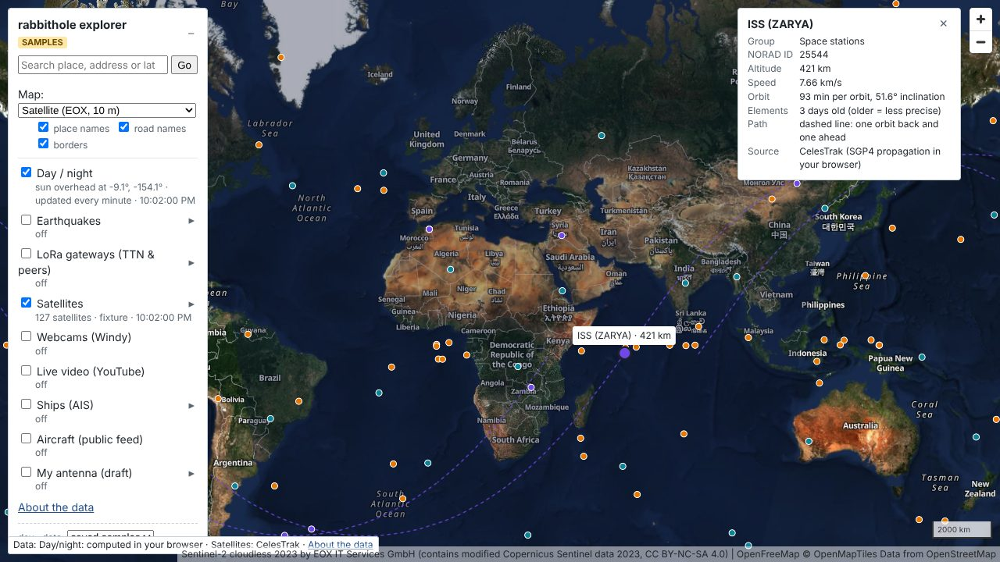
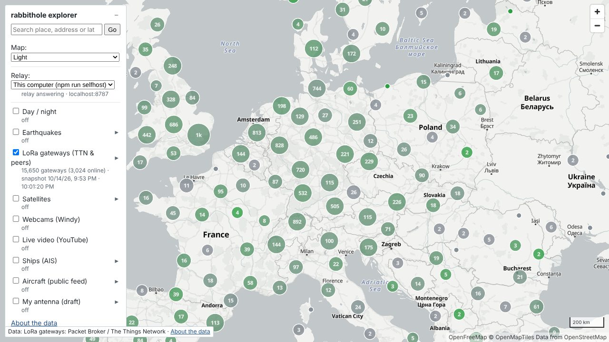

# rabbithole explorer

A lightweight, free **2D map of live public data**: aircraft, ships, earthquakes, satellites,
LoRa gateways, webcams and more. Every data type is its own layer that you switch on and off;
a layer that is off makes no network requests. Built to stay smooth on a laptop with integrated
graphics, with no accounts, no tracking and no ads.



| Earthquakes (USGS, past month, M4.5+) | Satellites and day/night | LoRa gateways (The Things Network & peers) |
| --- | --- | --- |
|  |  |  |

## Layers

| Layer | Source | Notes |
| --- | --- | --- |
| Aircraft | [adsb.lol](https://adsb.lol) (or [adsb.fi](https://adsb.fi)) | Positions every 5–10 s, smooth movement in between. Click a plane for its route guess, rough ETA and today's path. |
| Ships (AIS) | [AISStream](https://aisstream.io) | Coloured by type; moving ships point along their course. |
| Earthquakes | [USGS](https://earthquake.usgs.gov) | Pick a minimum magnitude and a period from the last hour to 20 years. |
| Satellites | [CelesTrak](https://celestrak.org) | Stations, GPS, weather and bright satellites, computed in your browser once a second. Click for the orbit track. |
| LoRa gateways | [Packet Broker](https://mapper.packetbroker.net) | Daily snapshot; green = online. |
| Webcams | [Windy](https://www.windy.com/webcams) | Latest picture and a 24 h timelapse for public webcams. |
| Live video | Hand-picked public YouTube live webcams | Ports, airports, volcanoes, nature; nothing loads until you click. |
| Day / night | Computed locally | Where the sun is up right now. |
| My antenna (**draft**) | Your own ADS-B receiver | Compares what your own antenna hears with the public feeds ("heard by both", "only mine", "only public"). Stays on your computer. Not yet tested with real hardware. |

Background maps: colour, light, dark, black & white ([OpenFreeMap](https://openfreemap.org)),
satellite ([EOX Sentinel-2 cloudless](https://s2maps.eu)), yesterday's satellite view
([NASA GIBS](https://earthdata.nasa.gov/gibs)) and, with your own free key, sharp satellite
imagery from [MapTiler](https://www.maptiler.com). Place search uses
[Nominatim](https://nominatim.org) (only when you press Enter).

## Privacy and ethics

- No accounts, cookies, analytics or ads. Your settings stay in your own browser.
- Nothing is stored: no history of aircraft or ships, short trails in memory only.
- No military filters, no owner names, no search or alerts by registration, tail number or
  ship ID.
- Webcams are public scenic, city and traffic cameras only: never private or unsecured cameras.
- Your own antenna's data never leaves your computer.

## How it works

The app is a static web page: once loaded, everything runs in your browser. Most sources are
fetched directly. Three cannot be: the aircraft feeds don't allow browser access (CORS), and
AISStream and Windy need secret keys. For those the page talks to a small **relay** (in
`worker/`): a Cloudflare Worker that fetches on the page's behalf and keeps the keys to itself.

```
browser ──► USGS, CelesTrak, map tiles, search, webcam pictures   (direct)
browser ──► relay ──► aircraft feeds, AISStream (ships), Windy (webcam list)
browser ──► your own ADS-B receiver on your network                (antenna overlay)
```

## Three ways to run it

### 1. Use the hosted site

Coming soon (GitHub Pages). Nothing to install; it uses a shared relay.
Limitation: the aircraft feeds refuse requests from Cloudflare's shared servers, so on the
hosted site aircraft ask you to run your own relay (option 2). Ships, webcams and everything
else work.

### 2. Run everything on your computer (recommended for aircraft)

Needs **Node.js 22.12 or newer** and **git**. No Cloudflare account.

```bash
git clone https://github.com/RafailDD/rabbithole_explorer
cd rabbithole_explorer
npm install
npm run setup      # optional: paste your own AISStream and Windy keys (see below)
npm run selfhost   # starts the relay (localhost:8787) and the app (localhost:5173)
```

Open <http://localhost:5173> and choose **Relay: This computer** in the panel. `Ctrl+C` stops
both. The first run also installs the relay's tools (about a minute).

Keys (free, optional; each one only enables its own layer):

| Key | Enables | Where |
| --- | --- | --- |
| AISStream | Ships | <https://aisstream.io> (sign in with GitHub, then API Keys) |
| Windy Webcams | Webcams | <https://api.windy.com> (Webcams API, free plan) |
| MapTiler | Sharp satellite map | <https://cloud.maptiler.com/account/keys/>, pasted in the panel |

Aircraft, earthquakes, satellites, LoRa, live video and day/night need no key. `npm run setup`
writes the relay keys to `worker/.dev.vars`, which never leaves your computer and is ignored
by git.

### 3. Your own always-on relay on Cloudflare

For your own relay on the internet (for example to use it from your phone), deploy the
same relay to your own free Cloudflare account:

```bash
cd worker
npm install
npx wrangler login
npx wrangler secret put AISSTREAM_KEY   # paste your key
npx wrangler secret put WINDY_KEY       # paste your key
npx wrangler deploy                     # prints https://rabbithole-relay.<you>.workers.dev
```

Add the address of the page that will use it to `ALLOWED_ORIGINS` in `worker/wrangler.toml`
(the relay only answers pages listed there), then pick **Relay: Custom address** in the
panel and paste the workers.dev address. The same aircraft limitation as option 1 applies.

Provider limits still apply to your own keys: AISStream allows one connection per key, and
Windy's free plan allows 300 requests per minute, which is plenty for one person.

## Development

```bash
npm run dev        # the app only (http://localhost:5173), using whichever relay is selected
npm run build      # type-check + static build into dist/
npm run gateways   # refresh the LoRa snapshot (public/data/lora-gateways.json)
npm run streams    # check that the hand-picked live streams are still live
```

`.github/workflows/site.yml` type-checks and builds every push, and once the repository is public
publishes the site to GitHub Pages daily with a fresh LoRa snapshot (repository variable
`RELAY_URL` = the hosted relay). `?feeds=fixtures` runs the app on saved sample data (offline,
repeatable).
`tools/smoke-test.cjs` is a headless browser test (Playwright); `tools/fake-decoder.mjs` is a
stand-in ADS-B receiver for the antenna overlay. TypeScript + Vite + MapLibre GL JS, no UI
framework. `CLAUDE.md` holds the detailed design notes.

## Credits and licences

Code: **MIT** (see `LICENSE`). Third-party code and data stored in this repository are listed in
`THIRD_PARTY_NOTICES.md`.

Data belongs to its providers and is shown with their attribution in the map's credit line and
the in-app **About the data** panel. Notably: aircraft data © adsb.lol contributors (ODbL),
map data © OpenStreetMap contributors (ODbL), Sentinel-2 cloudless by EOX (CC BY-NC-SA 4.0,
non-commercial), webcams provided by [windy.com](https://www.windy.com/)
([add a webcam](https://www.windy.com/webcams/add)); webcam pictures and videos belong to their
operators and channels. This is a non-commercial hobby project.
